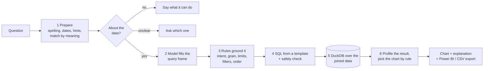

# Architecture

LocalLens turns a plain-language question into a chart, on one machine, with no internet connection.
A small language model (SLM) does one narrow job; ordinary, testable code does everything else.

## The one rule

> **The model never writes SQL.** It only fills in a typed form (the *query frame*). Code turns the form into SQL
> with fixed templates, checks the SQL, and runs it.

That is why a 0.5-billion-parameter model is enough, and why a wrong answer can be traced to one step.

## How a question flows



| Step | What happens | Code |
|---|---|---|
| 1 Prepare | fix typos, resolve "last quarter" / "December 2025" / fiscal years to dates, find column and value mentions, match unknown words by meaning | `nlu/preprocess.py`, `nlu/embeddings.py` |
| gate | refuse chatter; ask when a word could mean two columns, or a "by <word>" is unexplained | `core/pipeline.py` |
| 2 Model | Qwen2.5-0.5B (4-bit, CPU) fills the frame; its output is forced into a JSON schema whose column fields are lists of the real columns, so it cannot invent one | `nlu/slm.py`, `query/frame.py` |
| 3 Rules | keywords set the question type, time grain, top-N and sort direction; anything the model made up (a filter, a grouping, a limit) is dropped unless the question says it | `nlu/rules.py`, `core/pipeline.py` |
| 4 SQL | one template per question type; then parsed with sqlglot: a single SELECT, only the `flat` view, only known columns | `query/sqlgen.py`, `query/validator.py` |
| 5 Run | DuckDB reads the stored Parquet files in place; the main table is joined to the others as one view called `flat` | `data/engine.py`, `data/ingest.py` |
| 6 Chart | describe the result (types, time order, number of categories), then the first matching rule in `viz/charts_rules.yaml` picks the chart | `data/profiler.py`, `viz/charts.py` |

The six question types: **trend, comparison, distribution, proportion, ranking, summary.**

## Your business knowledge (the semantic layer)

Each dataset carries definitions that the model cannot know. They live in the dataset's *registry* (`data/registry.py`):

| Concept | Effect | Who does the work |
|---|---|---|
| Column tags + synonyms + descriptions | which columns are metrics, categories, dates; what people call them | listed in the prompt, so the model can only choose among them |
| **Metrics** (measures) | a formula such as `SUM(profit)/SUM(sales)` | model picks the name; code inlines the formula |
| **Calculated columns** | a new per-row column (an order-size band) | part of the `flat` view |
| **Business rules** | a filter that is always on, or on when a phrase appears ("high value") | code adds it to the WHERE clause; the model is not involved |
| Fiscal year start | "last quarter", "FY2025" follow the financial calendar | date resolver |
| Verified examples | questions marked correct become examples shown to the model | the 3 closest are added to the prompt |

Every formula a user writes is parsed and must pass an allowlist (known columns, a fixed list of functions,
no subqueries, `*`, window functions or file functions), then is dry-run on a sample (`data/semantic.py`).
A bad definition is switched off with a message; the rest of the dataset keeps working.

## Programme layout

```
src/locallens/
  nlu/      understand the question     preprocess  rules  slm  embeddings
  query/    the structured form + SQL   frame  sqlgen  validator
  data/     datasets                    registry  ingest  autoprep  semantic  engine  profiler  demo
  viz/      charts and exports          charts (+ rules yaml)  export_pbi  adapters
  core/     the pipeline                pipeline  session  prefs
  server/   the web app                 app  config  db  security  auth  runtime  routes_*  serialize
web/        React + TypeScript (Vite), drawn with Vega-Lite; built into web/dist and served by the server
eval/       gold + held-out question sets and the runner     docs/EVAL.md has the results
```

`core/pipeline.py` has no web code, so any other front end (or a command line) can call `pipeline.ask(...)`.

## The web app

One process (FastAPI) serves the API and the built React app. State:

* **SQLite** (`data/server/app.db`): users, sessions, datasets (with their registry), conversations, messages, preferences, an audit log.
* **Files** (`data/server/datasets/<id>/*.parquet`): uploaded data, converted once to Parquet.
* **Memory**: the language model (loaded once, one question at a time), the embedding model, and up to 8 recently used datasets.

### Accounts and access

| Rule | How |
|---|---|
| First run creates the administrator; after that only an administrator adds people | `/api/auth/setup`, `/api/users` |
| Temporary passwords must be changed at first sign-in | `must_change_password` |
| Passwords are hashed with scrypt; sessions are random tokens stored hashed, in an HttpOnly, SameSite=Lax cookie | `server/security.py`, `server/auth.py` |
| 5 failed sign-ins lock that user+address for 5 minutes; unknown users cost the same time as wrong passwords | `LoginThrottle` |
| A dataset is **private** or **shared** (everyone may ask questions; only the owner or an administrator may change it) | `routes_datasets.dataset_row` |
| Chats are private to their author, **including from administrators** | `routes_chat` |
| Anything a user may not touch returns 404, not 403, so ids reveal nothing | all routes |
| State-changing calls need a header a foreign web page cannot send | CSRF middleware |

### Other protections

* Uploads: type allowlist, size cap, names rewritten to safe identifiers, never used as paths, nothing left behind on failure.
* CSV exports neutralise spreadsheet formulas (`=`, `+`, `-`, `@` at the start of text).
* Security headers on every response, including a Content-Security-Policy with no `unsafe-eval`.
* The model is given a time budget (30 s by default) so a stalled generation fails fast instead of hanging the server.
* Descriptions, formulas and examples have length limits because they end up in the model's prompt; the prompt is trimmed to fit its context window.

### Limits (be honest in a review)

* Meant for a trusted company network. Use HTTPS in front of it (`LOCALLENS_SECURE_COOKIES=1`); the app does not terminate TLS.
* One model, one question at a time: a busy server queues questions (up to 90 s, then "busy").
* Very large uploads are limited by the size cap, not by a row limit; an Excel "zip bomb" is not specifically defended against.
* There is no single sign-on or password-reset email; an administrator resets passwords.

## Patent claim map

| Claim | What it says (short) | Where | Status |
|---|---|---|---|
| 1, 14 | offline system / method: query in, entities and intent, query, result analysis, chart, display | whole pipeline; `scripts/check_offline.py` proves it runs with all network calls blocked | built |
| 2 | metrics, dimensions and time fields | `data/registry.py` tags; `query/frame.py` | built |
| 3 | token analysis mapped to schema metadata; structured intermediate form in predefined fields | `nlu/preprocess.py`, `query/frame.py` (`QueryFrame`) | built |
| 4 | classify into trend, comparison, distribution, proportion, ranking, summary | model + `nlu/rules.py` | built |
| 5, 8 | SQL from a predefined template, schema check before running | `query/sqlgen.py`, `query/validator.py` | built |
| 6 | result analysis: columns, types, time order, cardinality | `data/profiler.py` | built (aggregation level and dimensionality are implied by the question type, not measured separately) |
| 7 | domain-adapted with locally stored embeddings; fixed context window | `nlu/embeddings.py`; `nlu/slm.py` fits the prompt to 2048 tokens | built, modest: matches about a third of unseen paraphrases, never guesses (see `docs/EVAL.md`). It adapts the *input vocabulary*; the model itself is not fine-tuned |
| 9, 10, 11 | chart chosen by rule from dimensions, time, aggregation; axis, sort, rendering metadata; time to line, categories to bar | `viz/charts.py` + `charts_rules.yaml`; Vega-Lite spec; saved preferences | built |
| 12 | small model, no GPU | Qwen2.5-0.5B Q4, `n_gpu_layers=0` | built; speed measured on one laptop only |
| 13 | result and chart configuration go to Tableau **or** Power BI through an API adapter | `viz/adapters.py` (`BIAdapter`), `viz/export_pbi.py` | **Power BI: built as a file adapter** (a Power BI project that Desktop opens). It does not call a Power BI service API, and it has not been opened in Power BI Desktop yet. Tableau not built (the claim says "at least one") |
